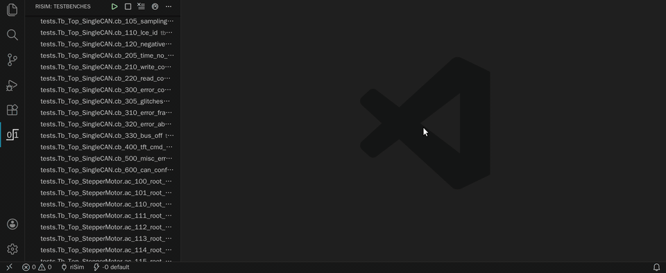
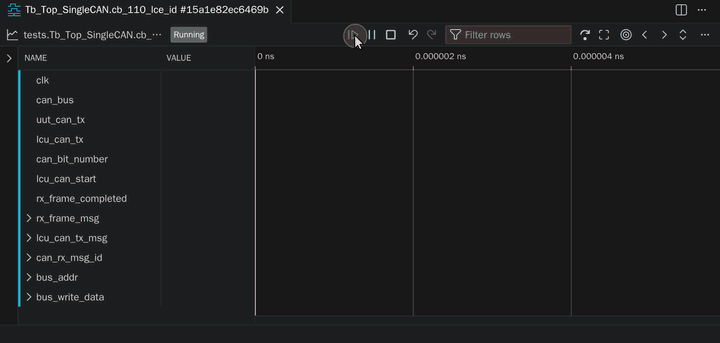

# [ riSim Studio ]

**riSim Studio is a VHDL simulation and verification environment built into VS Code.**
It discovers your VUnit testbenches, runs them on its own VHDL-2008 simulator, and streams live waveforms into an interactive viewer.
No separate simulator, Python, or VUnit installation is required.

- [1. Quick start](#1-quick-start)
  - [1.1. Write a VUnit testbench](#11-write-a-vunit-testbench)
  - [1.2. Configure your sources](#12-configure-your-sources)
  - [1.3. Discover your testcases](#13-discover-your-testcases)
  - [1.4. Run and debug](#14-run-and-debug)
- [2. Features](#2-features)
  - [2.1. Run your testbenches](#21-run-your-testbenches)
  - [2.2. Watch live waveforms](#22-watch-live-waveforms)
  - [2.3. Keep an eye on runs and simulations](#23-keep-an-eye-on-runs-and-simulations)
  - [2.4. Language server for VHDL](#24-language-server-for-vhdl)
  - [2.5. Use riSim from the command line and in CI](#25-use-risim-from-the-command-line-and-in-ci)
  - [2.6. Pin the riSim version of a project](#26-pin-the-risim-version-of-a-project)
  - [2.7. Navigate VHDL](#27-navigate-vhdl)
- [3. Plans](#3-plans)
- [4. Requirements and limitations](#4-requirements-and-limitations)
- [5. Privacy](#5-privacy)
- [6. Documentation](#6-documentation)
- [7. Support](#7-support)
- [8. License](#8-license)



## 1. Quick start

Install [riSim Studio](https://marketplace.visualstudio.com/items?itemName=xq-Tec.risim) from the VS Code Marketplace, or search for "riSim Studio" in the **Extensions** view of VS Code.
An empty workspace is enough to get started.
We'll add a testbench, point `risim-config.toml` at it, and run our first simulation.

Skip to [1.2. Configure your sources](#12-configure-your-sources) if you already have a project.

### 1.1. Write a VUnit testbench

Unless you already have a VUnit testbench, create one and add a testcase.
Name the entity with a `tb_` prefix or `_tb` suffix, include the VUnit context, add a `runner_cfg : string` generic, and terminate with `test_runner_cleanup`.
More detail is in the [VUnit user guide](https://vunit.github.io/user_guide.html#vhdl-test-benches).

Create a `my_example` folder in your workspace and copy the following example into `my_example/tb_example.vhd`:

```vhdl
library vunit_lib;
context vunit_lib.vunit_context;

library ieee;
use ieee.std_logic_1164.all;

entity tb_example is
  generic (runner_cfg : string);
  signal clk : std_logic := '0';
end entity;

architecture tb of tb_example is
  signal counter: natural := 0;
  signal tick: std_logic := '0';
begin
  clk <= not clk after 5 ns;

  process (clk)
  begin
    if rising_edge(clk) then
      if counter < 10 then
        counter <= counter + 1;
        tick <= '0';
      else
        counter <= 0;
        tick <= '1';
      end if;
    end if;
  end process;

  process
  begin
    test_runner_setup(runner, runner_cfg);

    while test_suite loop

      if run("test_pass") then
        wait for 50 ns;
        assert tick = '0' report "This will pass";

      elsif run("test_fail") then
        wait until counter = 10;
        wait until counter = 0;
        wait until rising_edge(clk);
        assert tick = '0' report "This fails";

      end if;
    end loop;

    test_runner_cleanup(runner);
  end process;

end architecture;
```

Don't worry about the errors that are getting reported, they'll disappear once you add the configuration file in the next section.

### 1.2. Configure your sources

Add a `risim-config.toml` file at the root of your workspace folder, mapping source files to VHDL libraries:

```toml
[libraries.my_design]
files = ["my_example/tb_*.vhd"]
```

This compiles all matching VHDL files in the `my_example` folder into the `my_design` library.
Source files are searched automatically for VUnit testbenches.

### 1.3. Discover your testcases

Open the **riSim** view in the activity bar.
Once discovery completes, testbenches appear in the **Testbenches** sidebar.
Configuration problems show up in the VS Code **Problems** panel.

### 1.4. Run and debug

Click the run icon next to a testcase to execute it, or choose **Start in Paused Mode** to open the simulation in a **waveform view**.
Add signals from the view's **hierarchy pane** to display their waveforms.

## 2. Features

### 2.1. Run your testbenches

The **Testbenches sidebar** lists all testcases in your project.

- **Automatic discovery** of VUnit testcases from `risim-config.toml`, no `run.py`
- **Run one testcase or all of them** from the sidebar
- **Parallel execution**: simulations are scheduled across your CPU cores, within the simulation threads of your plan
- **Incremental recompiles**: edit sources and re-run; only what changed is recompiled
- **Multi-root workspaces**: each workspace folder can have its own `risim-config.toml`

### 2.2. Watch live waveforms

- **Live signal updates** stream into the waveform view while the simulation runs
- **Full run control**: run, pause, and stop from the sidebar or the waveform view
- **Build a view from the hierarchy pane**: search for signals, add the signals you select, add a scope's signals or an entire subtree from the scope's context menu, or drag a scope onto the signal list
- **Several views per simulation**: **Open Waveform** or **New Waveform View** on a simulation row; views follow reruns of their testcase and are restored after a window reload
- **Display options**: signal colors, separators, binary/decimal/hexadecimal radix, analog and literal drawing modes
- **Navigation**: one-click zoom to fit, transitions and values to jump to, delta cycles, time units from femtoseconds to seconds



### 2.3. Keep an eye on runs and simulations

The **dashboard** shows everything that is running in one place.
Open it with the dashboard icon in the **Testbenches** sidebar's title bar, or with **riSim: Open Dashboard** from the command palette.
It stays open across window reloads.

- **Every test run** in your workspaces, including those started by another VS Code window or the command line: compile progress, the testcases of each run with their results and durations, and the last finished runs
- **Last results** of all testcases, with when they finished and how long they took; filter by name and sort by state, finish time or duration
- **Rerun failed testcases** of a run or of a whole workspace
- **Simulation statistics:** simulated time and speed, realtime duration

### 2.4. Language server for VHDL

- **Errors and warnings** in your VHDL files appear in the editor and the **Problems** panel while you edit, for every file of your project, open or not
- **Syntax highlighting** for `.vhd`, `.vhdl` and `.vho` files

### 2.5. Use riSim from the command line and in CI

Run **riSim: Install Command-Line Tools** from the command palette to install `risim` on your `PATH`, or install it without VS Code with the installer of the [download page](https://risim-studio.com/download/).

- `risim list`, `risim compile` and `risim simulate` work on the same testbenches, compiled libraries and results as the extension
- A live view of the running testcases in the terminal, and exit codes for scripts and CI

### 2.6. Pin the riSim version of a project

A project pins its riSim version in `risim-config.toml`:

```toml
[toolchain]
version = "1.0"
```

- The extension runs the newest installed 1.0.x for that folder, and installs it if needed
- `risim toolchain override set <version>` pins a directory for you only, without changing the project
- If a pinned version doesn't fit this version of the extension, the extension offers to change the pin or to install the matching extension version

### 2.7. Navigate VHDL

The riSim language server, which comes with the extension, analyzes your VHDL files while you edit them: every file of your projects, and the VHDL files you open outside them.

- **Semantic highlighting**: names are colored by what they denote, such as signals, ports, generics, constants, types, subprograms and labels
- **Go to Definition** and **Go to Declaration** lead to the declaration of a name
- **Go to Implementations** leads from an entity to its architectures, and from a package, subprogram, protected type, deferred constant or incomplete type to its body or full declaration
- **Find All References** and the highlights of a name in its file include end names, selected names and use clauses, and the highlights tell where an object is written and where it is read
- **Rename Symbol** renames a declaration in every file of your projects, open or closed
- **Hover** shows a name's declaration, and its value if it is static
- **Outline**, breadcrumbs and **Go to Symbol in Editor** show a file's design units, declarations and labeled statements
- **Go to Symbol in Workspace** searches the design units and declarations of your projects, without those inside subprograms and processes; it answers from the latest analysis, so it can lag behind your edits briefly
- Positions in files that aren't open assume that VS Code reads them as UTF-8, its default; with `files.encoding` set to a Latin-1 encoding, columns after non-ASCII characters can be off
- The language server uses the riSim version that comes with the extension, even where a project pins another one, so its results can differ from those of a compile
- The language status item of VHDL files (the `{}` in the status bar) shows whether the language server runs; **riSim: Restart Language Server** from the command palette starts it again

## 3. Plans

- **Free:** 2 simulation threads per machine, no license key or registration necessary, for operating systems running directly on their hardware; not for virtual machines or containers
- **Trial:** riSim Pro on one machine for 30 days, also in virtual machines and containers; [request a trial](https://risim-studio.com/trial/) and enter its key with **riSim: Enter License Key**
- **Pro:** node-locked seats and floating licenses; available soon

The [pricing page](https://risim-studio.com/pricing/) has the details.

## 4. Requirements and limitations

- **Platforms:** VS Code 1.116 or newer, on Linux x64 with glibc 2.28 or newer (such as RHEL 8, Debian 11, Ubuntu 20.04 and newer) or Windows x64
- **Language:** a subset of VHDL-2008, analyzed and simulated with riSim's own simulator; Verilog and SystemVerilog aren't supported yet ([supported languages and limitations](https://risim-studio.com/docs/language_support/))
- **Testbenches:** VUnit builtins `com` and `osvvm` are added automatically
- **No full `run.py` support:** riSim builds your project from `risim-config.toml`; VUnit's Python hooks (`pre_config`, `post_check`) are not available

## 5. Privacy

riSim Studio runs your simulations on your machine and sends no telemetry.
It connects to the internet only

1. to download toolchains from `dl.risim-studio.com`, which you can turn off with the environment variable `RISIM_OFFLINE`
2. on a machine where a license key has been activated, to the license server

See the [riSim Studio Software Privacy Notice](https://risim-studio.com/privacy-policy/software/).

## 6. Documentation

The [riSim Studio documentation](https://risim-studio.com/docs/) contains more details:

- [Getting started](https://risim-studio.com/docs/getting_started/)
- [risim-config.toml](https://risim-studio.com/docs/getting_started/#configuration)
- [Running testbenches in VS Code](https://risim-studio.com/docs/vscode/)
- [Waveforms](https://risim-studio.com/docs/vscode/#waveforms)
- [Command line](https://risim-studio.com/docs/command_line/) and [CI](https://risim-studio.com/docs/command_line/#ci)
- [The free plan](https://risim-studio.com/docs/licenses/#free) and [licenses](https://risim-studio.com/docs/licenses/)
- Troubleshooting [in VS Code](https://risim-studio.com/docs/vscode/#troubleshooting) and [on the command line](https://risim-studio.com/docs/command_line/#troubleshooting)

## 7. Support

Report bugs and ask questions by [opening an issue](https://github.com/xq-tec/risim-studio/issues/new) in this repository.
Extension logs are in the **Output** panel under **riSim**, and those of the VHDL language server under **riSim Language Server**.
Please include them when reporting a problem.
Issues are public, so leave out anything confidential, such as code you can't share or license keys.
For those, and for questions about your license or trial, write to <support@risim-studio.com>, or use the [contact form](https://risim-studio.com/contact/).
To report a security vulnerability, see [Security](https://risim-studio.com/security/).

## 8. License

riSim Studio is proprietary software, licensed under the [riSim Studio License Terms](https://risim-studio.com/terms/).

Published by xq-Tec GmbH; see the [legal information](https://risim-studio.com/legal-information/).
